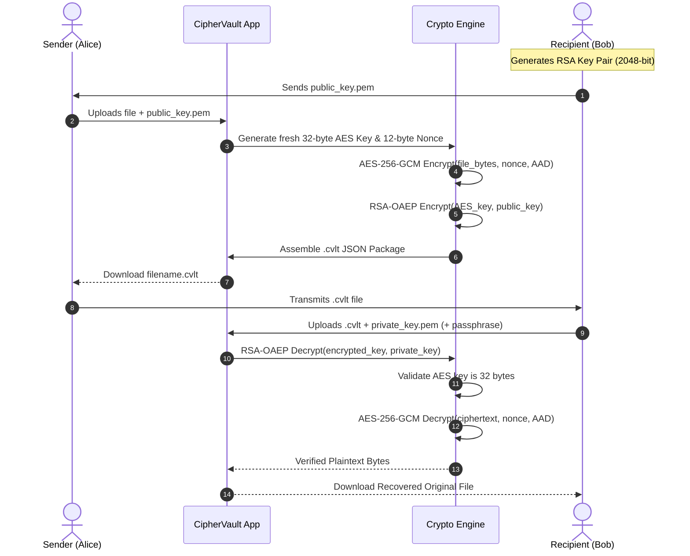

# CipherVault Lite: A Hybrid File Encryption and Decryption System Using AES and RSA

[](https://www.python.org/)
[](https://streamlit.io/)
[](https://cryptography.io/)
[](tests/)

---

## 1. Abstract
**CipherVault Lite** is a desktop-accessible local web application engineered for the **Cryptography and Network Security (CNS)** undergraduate course curriculum. It demonstrates a practical implementation of **Hybrid Cryptography**, combining the high-speed computational efficiency of symmetric encryption (**AES-256-GCM**) with the robust key-distribution capabilities of asymmetric encryption (**RSA-OAEP**). The application encrypts arbitrary file formats (documents, images, archives) locally, seals the one-time symmetric session key using the recipient's RSA public key, and packages the payload into a versioned `.cvlt` envelope. Cryptographic authentication prevents undetected tampering with either the ciphertext or its associated metadata.

---

## 2. Problem Statement
In distributed computing and digital communications, sharing confidential files without encryption exposes sensitive data to passive eavesdropping and active interception. 
- **Pure Symmetric Systems (e.g. AES alone):** Face the classic **key-distribution problem**—both parties must securely share a secret key beforehand across an insecure channel.
- **Pure Asymmetric Systems (e.g. RSA alone):** Are computationally intensive (modular exponentiation) and cannot encrypt arbitrary-sized files due to mathematical padding constraints (e.g., RSA-2048 with OAEP can encrypt at most 190 bytes).

**CipherVault Lite** resolves this dilemma by implementing hybrid encryption: symmetric cryptography encrypts the heavy bulk data, while asymmetric cryptography protects the lightweight symmetric key.

---

## 3. Project Objectives
1. **Demonstrate Symmetric Encryption:** Implement authenticated AES-256 in Galois/Counter Mode (GCM).
2. **Demonstrate Asymmetric Encryption:** Implement RSA with OAEP padding (SHA-256) for session key protection.
3. **Illustrate Hybrid Cryptosystem Architecture:** Provide an educational, end-to-end demonstration of session key encapsulation.
4. **Universal Format Support:** Support arbitrary file types (PDF, DOCX, TXT, PNG, JPG, CSV, ZIP) as raw byte streams.
5. **Authenticated Tamper Detection:** Verify integrity using GMAC authentication tags and Additional Authenticated Data (AAD).
6. **Provide an Intuitive Local Interface:** Deliver an interactive Streamlit UI designed for academic demonstration and viva examinations.
7. **Adhere to Secure Coding Practices:** Prevent key leakage, enforce strict schema validation, and sanitize user-supplied filenames.

---

## 4. Technologies Used
- **Programming Language:** Python 3.11+ (Tested on Python 3.14)
- **User Interface Framework:** Streamlit
- **Testing Frameworks:** `pytest` and Python `unittest`
- **Operating System:** Microsoft Windows 10 / 11 (Cross-platform compatible)

---

## 5. Python Libraries Used
- **`cryptography` (v42.0+):** Industry-standard primitives (`AESGCM`, `rsa`, `padding`, `hashes`, `serialization`).
- **`json` & `base64`:** Serializing and encoding binary fields into the `.cvlt` package envelope.
- **`secrets` & `os`:** Cryptographically secure pseudo-random number generation (`token_bytes`, `urandom`).
- **`io`, `pathlib`, `re`:** Safe binary memory buffers and path traversal prevention.
- **`time` & `datetime`:** Performance profiling and ISO UTC timestamping.

---

## 6. Cryptography Concepts Used
- **Hybrid Encryption:** Combination of symmetric session keys and asymmetric public/private key pairs.
- **AEAD (Authenticated Encryption with Associated Data):** Simultaneous confidentiality and integrity guarantees.
- **Galois/Counter Mode (GCM):** Counter mode encryption combined with Galois Field multiplication for authentication.
- **Optimal Asymmetric Encryption Padding (OAEP):** Randomized padding scheme providing IND-CCA2 security against chosen-ciphertext attacks.
- **PKCS#8 & Password-Based Key Derivation:** Encrypted PEM private key storage.
- **Nonce Freshness:** Guarantees semantic security; identical files yield different ciphertexts.

---

## 7. AES-256-GCM Explanation
Advanced Encryption Standard (AES) with a 256-bit key operating in Galois/Counter Mode (GCM) is an AEAD primitive:
1. **Confidentiality:** Uses CTR (Counter) mode to encrypt plaintext blocks by XORing them with AES keystream blocks.
2. **Authenticity:** Computes a 128-bit (16-byte) authentication tag over both the ciphertext and Additional Authenticated Data (AAD) using universal hashing over $GF(2^{128})$ (GMAC).
3. **Nonce Uniqueness:** A fresh 96-bit (12-byte) nonce is generated for every encryption session. Nonces are never reused.
4. **Tamper Rejection:** Any alteration to the ciphertext or AAD causes the computed tag to differ, raising an immediate authentication error without decrypting untrusted plaintext.

---

## 8. RSA-OAEP Explanation
RSA encryption uses a trapdoor one-way permutation based on the integer factorization problem.
- **Key Sizes:** 2048-bit (default minimum), 3072-bit, or 4096-bit.
- **Padding:** Optimal Asymmetric Encryption Padding (OAEP) with Mask Generation Function 1 (MGF1) and SHA-256.
- **Security Justification:** Textbook RSA ($c = m^e \pmod n$) is deterministic and completely vulnerable to mathematical attacks. Older PKCS#1 v1.5 padding is susceptible to Bleichenbacher's chosen-ciphertext attack. OAEP injects cryptographic randomness, rendering the scheme IND-CCA2 secure.

---

## 9. Hybrid Encryption Workflow



---

## 10. System Architecture

```text
┌────────────────────────────────────────────────────────┐
│               Streamlit Web Interface                  │
│  [ Home ] [ Encrypt File ] [ Decrypt File ] [ Keys ]   │
└───────────────────────────┬────────────────────────────┘
                            │
┌───────────────────────────▼────────────────────────────┐
│                    crypto_utils/                       │
│  ┌──────────────────┐  ┌─────────────────────────────┐ │
│  │  key_manager.py  │  │       file_format.py        │ │
│  │  - RSA Gen       │  │  - .cvlt Schema Validation  │ │
│  │  - PEM Load/Dump │  │  - Filename Sanitizer       │ │
│  │  - PKCS#8 Pass   │  │  - Canonical AAD Builder    │ │
│  └────────┬─────────┘  └──────────────┬──────────────┘ │
│           │                           │                │
│  ┌────────▼─────────┐  ┌──────────────▼──────────────┐ │
│  │   encryption.py  │  │        decryption.py        │ │
│  │  - AES-256-GCM   │  │  - RSA-OAEP Key Recovery    │ │
│  │  - RSA-OAEP Key  │  │  - Authenticated AEAD Check │ │
│  └──────────────────┘  └─────────────────────────────┘ │
└───────────────────────────┬────────────────────────────┘
                            │
┌───────────────────────────▼────────────────────────────┐
│               `cryptography` Library                   │
│      Hazmat Primitives / OpenSSL Backend Engine        │
└────────────────────────────────────────────────────────┘
```

---

## 11. Project Folder Structure

```text
CipherVault-Lite/
|-- app.py                      # Main Streamlit web application & UI workflows
|-- requirements.txt            # Python dependencies (streamlit, cryptography, pytest)
|-- README.md                   # Comprehensive project documentation
|-- .gitignore                  # Git ignore rules for keys, caches, and venv
|
|-- crypto_utils/               # Cryptographic core modules
|   |-- __init__.py             # Public API exports
|   |-- key_manager.py          # RSA key generation, PEM serialization & loading
|   |-- file_format.py          # .cvlt package envelope, Base64 & filename sanitizer
|   |-- encryption.py           # AES-256-GCM file encryption & RSA-OAEP key wrapping
|   |-- decryption.py           # RSA key unwrapping & authenticated AES-GCM decryption
|
|-- tests/                      # Automated test suite (25 tests)
|   |-- test_key_management.py  # RSA key pair tests & password protection
|   |-- test_encryption.py      # Encryption tests, nonces, limits & leak checks
|   |-- test_decryption.py      # Roundtrip tests (Text, PDF, Images) & bad keys
|   |-- test_integrity.py       # AEAD tag tampering, corrupted packages, invalid base64
|
|-- docs/
|   |-- project_report.md       # B.Tech academic mini-project report draft
|
|-- screenshots/                # Application demo screenshots placeholder
    |-- .gitkeep
```

---

## 12. System Requirements
- **OS:** Windows 10 / Windows 11 (macOS / Linux also supported)
- **Processor:** Any modern dual-core Intel/AMD processor or Apple Silicon
- **RAM:** Minimum 2 GB (4 GB recommended)
- **Disk Space:** ~200 MB for Python environment and dependencies
- **Python:** Python 3.11 or newer

---

## 13. Installation Instructions

### Step 1: Open Terminal / Command Prompt
Open Command Prompt or PowerShell in the project directory:
```powershell
cd "c:\path\to\CipherVault-Lite"
```

### Step 2: Create a Virtual Environment (Recommended)
```powershell
python -m venv .venv
```

### Step 3: Activate the Virtual Environment
**On Windows (Command Prompt):**
```cmd
.venv\Scripts\activate.bat
```
**On Windows (PowerShell):**
```powershell
.venv\Scripts\Activate.ps1
```

### Step 4: Install Dependencies
```powershell
python -m pip install -r requirements.txt
```

---

## 14. How to Run the Application
Execute the Streamlit application using:
```powershell
python -m streamlit run app.py
```
Streamlit will automatically open your default web browser at `http://localhost:8501`.

---

## 15. User Guide: Step-by-Step

### A. How to Generate and Protect Keys
1. Navigate to **🔑 Key Management** in the sidebar.
2. Select your desired RSA key size (Default: `2048` bits).
3. Check **Protect Private Key with Password** and enter a secure passphrase.
4. Click **Generate RSA Key Pair**.
5. Download both `public_key.pem` and `private_key.pem`.
6. Share `public_key.pem` with anyone who needs to send you encrypted files. Keep `private_key.pem` secret!

### B. How to Encrypt a File
1. Navigate to **🔒 Encrypt File**.
2. Upload any document or image (up to 25 MiB).
3. Upload the recipient's `public_key.pem` (or generate a quick pair directly in-page).
4. Click **🔐 Encrypt File Now**.
5. Review metrics (Original size, package size, processing time).
6. Click **💾 Download Encrypted Package** to save `filename.cvlt`.

### C. How to Decrypt a File
1. Navigate to **🔓 Decrypt File**.
2. Upload the `.cvlt` package.
3. Upload your `private_key.pem`.
4. If the private key was encrypted, enter your passphrase.
5. Click **🔓 Decrypt & Verify File**.
6. The application validates the envelope, decrypts the session key, and verifies the AES-GCM authentication tag.
7. Click **💾 Download Recovered File** to save your verified plaintext file.

---

## 16. Security Features
- **Authenticity with AAD:** Additional Authenticated Data binds package metadata (filename, original size, version) to the ciphertext. Tampering with the JSON headers fails decryption.
- **Strict Size Limits:** Strict 25 MiB payload limits prevent memory exhaustion / Denial of Service (DoS).
- **Safe Filename Sanitization:** Path traversal patterns (`../`, `C:\`, null bytes, Windows reserved devices like `CON`, `NUL`) are automatically stripped.
- **No Insecure Modes:** Never uses ECB mode or unauthenticated CBC mode.
- **Zero Plaintext Leakage:** Plaintext and symmetric keys are zeroed in memory references after processing.
- **Fail-Safe Decryption:** Incomplete or failed authentications never return partial plaintext.

---

## 17. Limitations
- **Educational Scope:** Designed for local single-user academic demonstrations, not enterprise multi-tenant cloud deployments.
- **Memory Bound:** Files are buffered in memory; very large files (> 100 MB) are capped to prevent client-side browser crashes.
- **Key Recovery:** No key escrow exists. If the user loses their private key or forgets the passphrase, data recovery is mathematically impossible.

---

## 18. Testing Instructions
Run the automated test suite using `unittest`:
```powershell
python -m unittest discover tests
```
Or run using `pytest`:
```powershell
python -m pytest tests/ -v
```

### Test Coverage Summary:
- **`test_key_management.py`**: Key generation, PEM serialization, passphrase verification, invalid PEM handling.
- **`test_encryption.py`**: Empty files, size limits, plaintext leakage checks, fresh nonce verification.
- **`test_decryption.py`**: Exact byte roundtrips for Text, PDF, and PNG payloads, wrong key rejection, path traversal sanitization.
- **`test_integrity.py`**: Ciphertext tampering, tag alteration, corrupted packages, invalid base64, metadata forgery.

---

## 19. Project Demonstration Instructions (For College Viva)
1. **Show Key Generation:** Generate an RSA-2048 key pair with a passphrase and inspect the resulting PEM files.
2. **Demonstrate Encryption:** Encrypt a sample PDF or image and download the `.cvlt` package.
3. **Show Nonce Freshness:** Encrypt the exact same file a second time and compare the two `.cvlt` files in a text editor to show that nonces and ciphertexts are completely distinct.
4. **Demonstrate Decryption:** Upload the `.cvlt` package and private key, recover the file, and open it to verify byte-for-byte fidelity.
5. **Demonstrate Tamper Detection (Integrity Check):** Open the `.cvlt` file in Notepad, alter a single letter in the `ciphertext` string, upload it to the Decrypt page, and observe the immediate `Authentication tag mismatch` rejection!

---

## 20. Future Enhancements
- Support for Post-Quantum hybrid algorithms (e.g., ML-KEM / Kyber alongside RSA).
- Streaming encryption for gigabyte-scale video files using chunked AEAD.
- Digital signatures using RSA-PSS for sender identity verification.

---

## 21. Screenshot Placeholders
*(Screenshots can be placed in `screenshots/` directory)*
- `screenshots/01_home_screen.png`: [Placeholder: Home Interface Overview]
- `screenshots/02_encrypt_screen.png`: [Placeholder: File Encryption Workflow]
- `screenshots/03_decrypt_screen.png`: [Placeholder: File Decryption & Metrics]
- `screenshots/04_tamper_detection.png`: [Placeholder: Tamper Rejection Warning]

---

## 22. Repository Link
- **GitHub Repository:** *[Placeholder: https://github.com/your-username/ciphervault-lite]*
